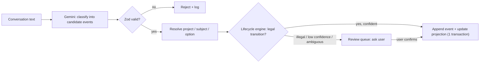
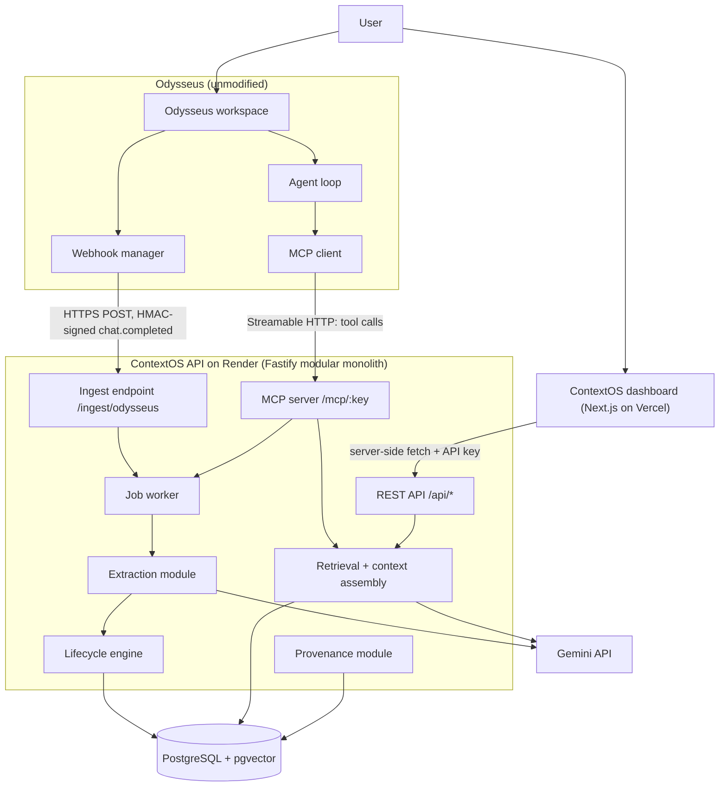
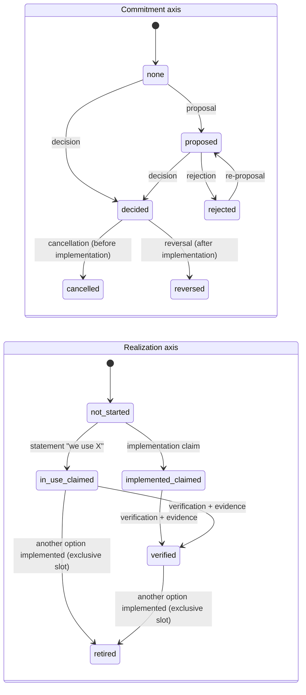
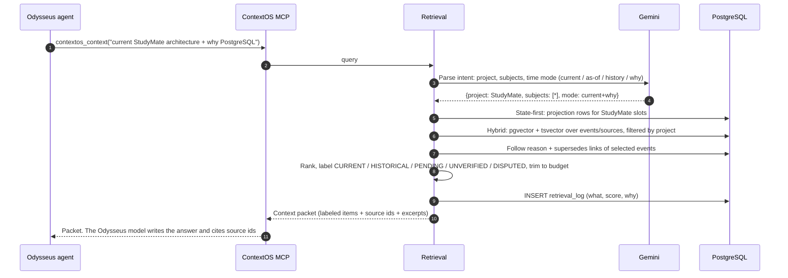
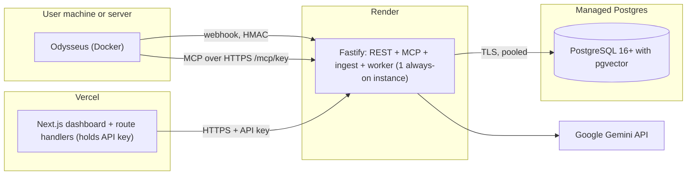

# ContextOS — Design Foundation (Parts A–D)

> Status: **Draft for team review. No code until approved.**
> Date: 2026-11-05
> Covers: A. Problem validation & competitor analysis · B. Scope & differentiation · C. Technology choices · D. System architecture
> Next (after approval): E. Database · F. API & MCP contracts · G. Frontend · H. Security · I. Evaluation · J. Roadmap · K. Demo

**Evidence labels used throughout**

| Label | Meaning |
|---|---|
| **[SRC]** | Verified by reading source code in `odysseus/` (commit `9d0d3720`) |
| **[RUN]** | Verified by executing code |
| **[DOC]** | Stated in official documentation (fetched 2026-11-05) |
| **[2ND]** | Secondary source (blog/review); treat as unconfirmed |
| **[ASSUMPTION]** | Our belief, not yet verified. Each one has a Phase 1 check |

---

## PART A — Problem Validation & Existing Solutions

### A.1 The problem, stated precisely

Memory systems answer *"what was said about X?"* We need *"what is true about X now, how did it get that way, and how sure are we?"*

That requires three things a fact store does not have:

1. **Commitment level.** A *proposal* is not a *decision*, and a decision is not an *implementation*.
2. **Time with two clocks.** When something happened (event time) is separate from when we learned it (record time).
3. **Evidence.** Which conversation said it, whether the user stated it or the model inferred it, and whether anything external confirms it.

### A.2 Odysseus: what it actually does (source-verified)

**"Brain"** is the UI name for the memory + skills panel. In code it maps to `memory`/`manage_memory`: `src/agent_loop.py:1615`, `src/agent_loop.py:11426` ("Saved user memory facts from Odysseus Brain"). **[SRC]**

| Aspect | What the code does | Evidence |
|---|---|---|
| **Storage** | Flat JSON array in `data/memory.json`. Each entry is `{id, text, timestamp, source, category, uses, owner, session_id?, pinned?}`. Atomic file replace on save. | `src/memory.py:261-278` **[SRC]** |
| **Vector index** | ChromaDB collection `odysseus_memories` (FastEmbed or custom embedding "lanes"). Metadata is only `{"source":"memory"}`. | `src/memory_vector.py:113-118` **[SRC]** |
| **Auto-extraction** | Runs on every 4th message pair, over the last 6 messages. The prompt asks for *"durable personal facts about the user"*, **max 2 facts**, each under 15 words, categories `identity/preference/fact/contact/project/goal`. | `routes/chat_helpers.py:1737-1740`, `services/memory/memory_extractor.py:73-91` **[SRC]** |
| **Dedup on write** | (1) Vector similarity ≥ **0.72** means skip. (2) Exact text match means skip. (3) Jaccard token overlap ≥ **0.6** means skip. | `memory_extractor.py:465-491`, `:262-275` **[SRC]** |
| **Consolidation** | Every 5 auto-added memories, an LLM "audit" rewrites the **whole list**. It merges entries and rewrites text **in place, keeping the old id**. No version history. A >50% deletion guard exists. | `memory_extractor.py:634-818` **[SRC]** |
| **Edit / delete** | MCP `edit` overwrites `text` and `timestamp`. `delete` hard-removes. No history either way. | `mcp_servers/memory_server.py:195-251` **[SRC]** |
| **Retrieval in chat** | Pinned memories + hybrid score `0.55·vector + 0.40·BM25 + 0.05·recency`. **At most 5 memories** injected, wrapped as untrusted context. | `src/chat_processor.py:92, 212-257, 328-365` **[SRC]** |
| **Temporal model** | One `timestamp` (record time; edits overwrite it). No event time, no validity interval. | `src/memory.py:280-295` **[SRC]** |
| **Lifecycle / decisions** | None. Categories exist but there is no status, no supersession, and no reasoning field. | whole memory module **[SRC]** |
| **Provenance** | `session_id` on auto-extracted entries only. No excerpt, no message reference. | `memory_extractor.py:503-506` **[SRC]** |
| **Conflict handling** | None explicit. Conflicting facts either coexist undifferentiated, or the newer one is **dropped as a "duplicate"** (see below). | **[SRC] + [RUN]** |
| **Provider abstraction** | `MemoryProvider` interface + `MemoryProviderRegistry` exist "so external providers can add recall/write behavior", but only `NativeMemoryProvider` is registered. | `src/memory_provider.py:33-40`, `src/app_initializer.py:111-113` **[SRC]** |

#### The defect we reproduced **[RUN]**

We ran Odysseus's own `_is_text_duplicate()` with an existing memory of `"StudyMate uses MongoDB as its database."`:

```
True   <- 'StudyMate uses PostgreSQL as its database.'      ← state change DROPPED as duplicate
False  <- 'StudyMate is considering PostgreSQL as its database.'
False  <- 'StudyMate decided to use PostgreSQL as its database.'
False  <- 'StudyMate migrated to PostgreSQL.'
```

The **most important update** (the new current state) is the one most likely to be discarded, because it shares the most words with the old state. The vector path runs first at threshold 0.72 and would plausibly drop it too. That is **[ASSUMPTION]**: not run, because it needs the embedding service. The proposal and decision sentences survive dedup, but they are stored as plain text with no status. So Odysseus would hold "MongoDB" (as a fact), "considering PostgreSQL" and "decided PostgreSQL", with nothing saying which one is current.

> **Not yet verified end-to-end:** we have not run the full 5-session StudyMate script through a live Odysseus chat. That is Phase 1, task 1, and it becomes our baseline measurement.

#### Odysseus integration surfaces (source-verified)

| Surface | What exists | Implication for ContextOS |
|---|---|---|
| **MCP client** | Supports **stdio**, **SSE** and **Streamable HTTP** (`src/mcp_manager.py:182-198`). HTTP uses an OAuth provider wrapper. **No custom headers** can be configured for HTTP/SSE servers (`:297`, `:386`). | We cannot rely on an `Authorization: Bearer` header from Odysseus. See D.6 for the workaround. |
| **MCP tool annotations** | Odysseus reads `readOnlyHint`/`destructiveHint` for plan-mode gating (`mcp_manager.py:310-313`). | Annotate our read tools as read-only. |
| **Does MCP get conversation history?** | **No.** Tool calls pass only the arguments the model chooses (`src/tool_execution.py:1453`, `mcp_manager.py:629`). The event bus (`src/event_bus.py`) carries **event names only**, no payload. | Installing an MCP server captures nothing by itself. |
| **Outbound webhooks** | `chat.completed` posts `{session_id, model, user_message, response[:2000]}`, signed with **HMAC-SHA256** in `X-Odysseus-Signature` (`src/webhook_manager.py:22-27, 418-426`; `routes/chat_helpers.py:1825-1829`). Public URLs only (private IPs blocked). One delivery attempt, **no retry** seen in `_deliver`. Not fired in compare mode. | **A passive, automatic capture path exists without modifying Odysseus.** This is the key integration finding. |
| **Skills** | User skills are `SKILL.md` files the agent can match and inject (`specs/memory-skills.md`). | We ship a `contextos` skill that tells the agent *when* to call our tools. |
| **Context budget** | `ROADMAP.md` lists "agent prompt/context bloat… tool schemas, skills, memory… eat the context" as high priority. | Keep the MCP tool count small (≤7) and the schemas terse. |

### A.3 Mem0, Zep, Letta, LangGraph

| | **Mem0** | **Zep / Graphiti** | **Letta** | **LangGraph + LangMem** |
|---|---|---|---|---|
| **What it is** | Memory layer / API for agents | Temporal knowledge-graph memory (Graphiti is the OSS engine) | Stateful agent framework (MemGPT lineage) | Agent framework with a persistence `Store`; LangMem adds extraction |
| **Representation** | Extracted text facts + vector index. Graph memory "built-in and automatic" **[DOC]** | Entity nodes + **fact edges** extracted from **episodes** (raw input) **[DOC]** | Memory **blocks** in context (agent-editable), **recall** (conversation history), **archival** (vector passages) **[DOC]** | Namespaced JSON documents with optional vector search **[DOC]**. Semantic/episodic/procedural memory types **[DOC]** |
| **Update model** | **ADD-only** in the current algorithm: *"nothing is overwritten or deleted"*. The old UPDATE/DELETE flow was retired **[DOC]** | LLM decides add vs update. The old fact is **invalidated, not deleted** **[DOC]** | The agent edits its own blocks via tools. Sleep-time agents consolidate in the background **[DOC]**/**[2ND]** | `create_memory_store_manager` does search → upsert → delete **[DOC]** |
| **Temporal** | *"Both facts are preserved with temporal context"*, but temporal signals are *"applied internally during ranking and are not returned"* **[DOC]** | **Bi-temporal**: `valid_at`/`invalid_at` (event time) + `created_at`/`expired_at` (system time) **[DOC]** | Messages are timestamped. No validity intervals in the docs we read | No built-in validity intervals in the docs we read |
| **Decision lifecycle** | Not found in docs read | Not built in. **Could be approximated** with custom edge types (e.g., `PROPOSED`, `DECIDED`) via its custom ontology **[DOC]** | Not built in | Not built in |
| **Decision reasoning** | Not found as a distinct field | Can live in fact text / custom edge attributes | Free-text in blocks | Free-text in documents |
| **Conflicts** | Kept side by side. Ranking prefers "current" **[DOC]** | Automatic invalidation of contradicted edges **[DOC]**. Zep notes validity fields *"do not establish that the source content or the derived fact is true"* **[DOC]** | Agent's judgment | Manager's LLM judgment |
| **Provenance** | Not described on the pages read | Facts are *"extracted from one or more episodes"* **[DOC]** | Recall memory = original messages | Developer-defined |
| **Human confirmation** | Not described | Not described | Not described | Not described |

> **Fairness note for judges.** Zep/Graphiti is the strongest prior art. It already does bi-temporal facts, invalidation instead of deletion, episode provenance and hybrid search. **We must not claim temporal memory or contradiction handling as novel.** Mem0 recently moved to non-destructive ADD-only memory, so "we don't overwrite history" is also not novel on its own.

**Adjacent prior art (non-AI):** Architecture Decision Records (ADRs) have long used statuses such as *Proposed / Accepted / Deprecated / Superseded*. ADRs are written by hand. Nobody keeps them up to date from conversations.

### A.4 The defensible gap

No system we examined does the following **out of the box**:

1. Treats a decision as a **state machine with two independent axes**: *commitment* (proposed → decided / rejected / cancelled / reversed) and *realization* (none → claimed implemented → verified → retired).
2. Lets the **LLM only classify**, while **deterministic code applies transitions**, rejects illegal ones, and routes them to a **human-confirmation queue**.
3. Separates **who asserted it**: user-stated vs model-inferred vs externally verified with attached evidence. It never lets an unverified claim override a verified state.
4. Answers *"what is current?"* from a **projected state table** (not similarity search) and labels every retrieved item **CURRENT / HISTORICAL / PENDING / UNVERIFIED / DISPUTED** with its source.

Zep could approximate (1)–(3) with a custom ontology and custom code. That is fine: our claim is **a purpose-built decision-intelligence layer**, not a new storage primitive.

**Pitch (one sentence):** *"Your AI remembers what you said. ContextOS remembers what you decided, what you actually shipped, and why, and it knows the difference."*

---

## PART B — Product Scope & Differentiation

### B.1 What ContextOS is

An **auto-maintained decision log** (think "living ADRs") for AI workspaces. It is fed by Odysseus conversations, queryable by Odysseus agents over MCP, and inspectable in its own dashboard.

### B.2 What it is NOT

- Not a chatbot or a replacement for Odysseus memory. Odysseus memory keeps handling personal facts (name, preferences).
- Not a general RAG system over documents. Documents are only an evidence source.
- Not a graph database product. Relationships live in Postgres tables.

### B.3 Scope boundary: what counts as a "decision subject"

ContextOS tracks **project-scoped subjects** ("slots") such as `StudyMate.database`, `StudyMate.hosting` and `StudyMate.auth_provider`. Each slot has:

- **Cardinality**: `exclusive` (one primary database) or `multi` (several libraries). Gemini suggests it; the user can override; code enforces it.
- **Options**: candidate values (`MongoDB`, `PostgreSQL`), each with its own lifecycle.

Anything that isn't a project decision (chit-chat, personal facts) is **ignored**. That is a deliberate precision-over-recall choice.

### B.4 Two capture paths (both needed)

| Path | Trigger | Strength | Weakness |
|---|---|---|---|
| **Passive: Odysseus webhook** `chat.completed` → `POST /ingest/odysseus` | Automatic after every chat response | Captures without relying on the agent | Assistant response truncated to 2,000 chars. No retry. Needs a public ContextOS URL |
| **Active: MCP `contextos_record`** | Agent calls it, guided by a `contextos` SKILL.md | Precise, with an explicit project, can attach evidence | Depends on the model choosing to call it |

Both write to the same ingestion pipeline. Dedup links them as **corroborating evidence**, not duplicates.

### B.5 MVP differentiation that judges can *see*

1. The 5-session StudyMate script. ContextOS answers *"MongoDB → decided PostgreSQL (Mar) → migrated (Apr) → verified (May), because relational queries"*, with clickable sources.
2. Side by side: the vector-memory baseline (and Odysseus memory, if it reproduces) gives a muddled or stale answer.
3. A conflicting statement ("we're on MongoDB") **after** verification goes to *"Needs confirmation"* instead of silently changing the state.

---

## PART C — Technology Choices

The stack is fixed by your requirements. This part explains *why it fits* and *where to be careful*, not whether to swap it.

| Choice | Why we need it | Why it fits | Alternatives | Trade-off / watch-out |
|---|---|---|---|---|
| **Fastify + TS** (backend) | Webhook ingest, REST, MCP host, background jobs in one process | Fast; JSON-schema-native; `fastify-type-provider-zod` pairs with Zod | Next.js API routes (no long-running jobs on Vercel), Express (slower, weaker typing) | One more deploy than Next-only, but needed for MCP + jobs |
| **Zod** | Validate HTTP input, MCP input, and **every Gemini output** | One schema → TS type + runtime check + JSON Schema for Gemini/MCP | Ajv, Valibot | Keep Zod → JSON-Schema conversion in one module so the schemas never drift |
| **PostgreSQL + pgvector** | Events, projections, graph, FTS **and** vectors with one transaction boundary | Hybrid retrieval in **one SQL query** (vector + `tsvector` + filters). No sync between stores | Pinecone/Qdrant + PG (two stores, consistency gaps), Neo4j for graph (unneeded at our scale) | HNSW on `vector` supports ≤2000 dims, so request 768-dim embeddings |
| **`pg` + raw SQL** (mandated) | Full control over the bitemporal and projection SQL | Recursive CTEs, `FOR UPDATE SKIP LOCKED` and partial indexes are natural in raw SQL | ORMs (forbidden) | More boilerplate. Mitigated with a repository per aggregate and typed row mappers |
| **Migrations** | Versioned schema | `node-pg-migrate` in **SQL-file mode**, or a 60-line runner over `migrations/*.sql` with a `schema_migrations` table | Prisma/Drizzle migrate (forbidden: ORM-coupled) | Pick one in Phase 2. A custom runner keeps zero ORM surface |
| **Postgres job table** instead of Redis | Webhook must return fast; extraction takes seconds | `ingest_jobs` + `SELECT … FOR UPDATE SKIP LOCKED` = durable queue, no new infra | Redis/BullMQ (extra service), in-memory queue (lost on restart) | Polling every 1–2s is fine at hackathon volume |
| **Gemini structured output** | Classify events into a strict schema | `responseSchema` constrains output. Zod re-validates anyway | Function calling (more overhead for pure extraction) | **[ASSUMPTION]** Pin exact model IDs in Phase 1 from the live Gemini model list. Use a Flash-class model for extraction, optionally a Pro-class model for synthesis |
| **Gemini embeddings** | Semantic search | Same vendor and key | Local FastEmbed | **[ASSUMPTION]** Confirm the current embedding model ID and that `outputDimensionality=768` is supported |
| **Official MCP TS SDK**, Streamable HTTP | Odysseus agents call our tools | Odysseus supports Streamable HTTP **[SRC]**. Hosted on Render, so no local process needed | stdio (needs a local process on the Odysseus host) | No custom headers from Odysseus, so auth goes in the URL (D.6) |
| **Next.js + shadcn + React Flow + Recharts** | Dashboard, graph, timeline | Standard and fast to build | — | Dashboard calls Fastify **through Next.js route handlers** so the API key stays server-side |
| **Render** (API) | Long-running Node process | Supports always-on web services | Fly.io, Railway | **Free tier spins down when idle. Odysseus webhooks don't retry, so events would be lost during cold start.** Use a paid instance for the demo week |
| **Postgres host** | pgvector | Neon, Supabase and Render Postgres all offer pgvector **[ASSUMPTION — confirm on chosen plan]** | — | Co-locate the region with Render |

**Explicitly not used:** Redis, Kafka, Kubernetes, Neo4j, microservices, LangChain. None solves a problem we actually have.

---

## PART D — System Architecture

### D.1 The core idea in one picture



**Rule:** Gemini proposes, code disposes. Gemini never writes to permanent tables.

### D.2 High-level architecture



**Reading the arrows**

- **User → Odysseus:** people keep working in Odysseus as usual.
- **Webhook manager → Ingest:** after each reply, Odysseus posts the exchange to ContextOS. This is the "automatic" path.
- **MCP client → MCP server:** when the agent needs project history (or wants to record something explicitly), it calls a ContextOS tool.
- **Ingest / MCP → Job worker:** writes return immediately. Slow Gemini work happens in the background from a Postgres job table.
- **Extraction → Gemini:** turns raw text into *candidate* events (JSON).
- **Extraction → Lifecycle engine:** the only component allowed to change memory state.
- **Retrieval → DB / Gemini:** finds relevant state and events. Gemini is used only to parse the question (and optionally draft an answer for the dashboard chat).
- **Dashboard → REST:** the browser talks to Next.js. Next.js talks to Fastify with a server-held key.

### D.3 Component architecture (modules inside the monolith)

| Module | Responsibility | Owns tables (conceptual) |
|---|---|---|
| `ingest` | Webhook verification, MCP record intake, source dedup (content hash), job enqueue | `sources`, `ingest_jobs` |
| `extraction` | Prompting Gemini, Zod validation, normalization of names/dates | — (pure) |
| `resolution` | Map mentions to project / subject / option, using aliases + embeddings; session→project binding | `projects`, `entities`, `entity_aliases`, `session_bindings` |
| `lifecycle` | **Deterministic reducer**: legal-transition table, conflict detection, projection updates, review queue | `events`, `decision_slots`, `slot_options` (projection), `review_items` |
| `graph` | Derive relationship edges with validity intervals from events | `relationships` |
| `retrieval` | Query parsing, state-first lookup, hybrid search, ranking, context packet assembly | `embeddings`, `retrieval_logs` |
| `provenance` | Source excerpts, citation validation, "why retrieved" explanations | (reads `sources`, `events`) |
| `mcp` | Tool registration (official SDK), maps tools to services | — |
| `api` | REST routes, rate limits, error mapping | — |
| `db` | Pool, transaction helper, migration runner, repositories (raw SQL) | — |

Dependency direction: `api`/`mcp` → services → repositories → `pg`. Services never import each other's repositories.

### D.4 The lifecycle model (the core innovation)

Each **option** inside a **slot** has two independent states:



**Why two axes?** "We decided PostgreSQL but haven't migrated" is `decided` + `not_started`. "We've been on Mongo since day one" is `none` + `in_use_claimed` (no recorded decision, but in use). One status field cannot represent both without collapsing a proposal into a decision or a decision into an implementation.

**How the slot's answer is derived (projection):**

| Question | Rule |
|---|---|
| **Current value** | Option with realization ∈ {in_use_claimed, implemented_claimed, verified} and not retired. Label: *VERIFIED* or *CLAIMED* |
| **Pending** | Options with commitment = decided and realization = not_started |
| **Open** | Options with commitment = proposed |
| **History** | All events ordered by `occurred_at`, then `recorded_at` |
| **As of date T** | Replay events with `occurred_at ≤ T` (and `recorded_at ≤ T` for "what did we know then") |

**When the engine asks the user instead of acting** (writes a `review_item`, projection unchanged):

| Situation | Example | Why ask |
|---|---|---|
| Illegal transition | "Cancel PostgreSQL" after it was implemented | Is it a cancellation or a reversal? |
| Unverified claim contradicts a **verified** state | "We're on MongoDB" after PostgreSQL verified | Never let a weaker claim override evidence |
| Second decision in an exclusive slot without "instead of" | "Decided MySQL" while PostgreSQL is decided | Did they change their mind or mean another project? |
| Project ambiguous | "We moved the DB to Postgres" with 2 active projects and no session binding | Wrong project = silent corruption |
| Low confidence | Gemini confidence < 0.7, or the hedging detector fires ("maybe", "I think") | Cheap to ask, expensive to be wrong |

**Accepted automatically:** legal transitions with confidence ≥ 0.7 and an unambiguous project. A repeat of an existing event (same slot / option / type within a window) becomes **corroboration** (extra source link). It is not stored as a new event and is not dropped.

**Epistemic origin on every event:** `user_stated` | `assistant_stated` | `model_inferred` | `externally_verified`. Assistant suggestions ("You should use Postgres") are recorded at most as **proposals**, never as decisions.

**Two clocks:** `occurred_at` (event time; from explicit dates like "in March", resolved relative to the source time, otherwise the source time with `time_precision='recorded'`) and `recorded_at` (when ContextOS ingested it). Corrections create new events. Old events are **never updated or deleted** except by an explicit user delete (soft delete + audit row).

### D.5 Sequence: ingestion

```mermaid
sequenceDiagram
    autonumber
    participant O as Odysseus
    participant I as ContextOS ingest
    participant Q as Job table (PG)
    participant W as Worker
    participant G as Gemini
    participant L as Lifecycle engine
    participant DB as PostgreSQL

    O->>I: POST /ingest/odysseus (chat.completed, X-Odysseus-Signature)
    I->>I: Verify HMAC, size limit, timestamp freshness
    I->>DB: INSERT source (content hash, ON CONFLICT DO NOTHING)
    I->>Q: INSERT ingest_job
    I-->>O: 202 Accepted (fast; Odysseus doesn't retry)
    W->>Q: SELECT ... FOR UPDATE SKIP LOCKED
    W->>G: Extract candidate events (responseSchema)
    G-->>W: JSON candidates
    W->>W: Zod validate, normalize dates/names
    W->>DB: Resolve project/subject/option (aliases + vectors)
    W->>L: Propose events
    alt legal + confident + unambiguous
        L->>DB: BEGIN, insert event(s), update projection, edges, embeddings, COMMIT
    else needs a human
        L->>DB: INSERT review_item (projection unchanged)
    end
```

### D.6 Sequence: retrieval (Odysseus agent asks)



**Design choice (differs from the brief's flow):** for MCP calls, ContextOS returns a **labeled context packet**, not a Gemini-written answer. Odysseus's own model composes the reply. This avoids a second LLM hop, keeps Odysseus in control, and keeps ContextOS deterministic and testable. Gemini answer generation is used in the **ContextOS dashboard chat**, and as an optional `mode:"answer"` flag.

**How outdated info is kept out of "current":** current-state questions are answered **from the projection table first**. Search results whose option is retired, reversed or superseded are only included with a `HISTORICAL` label, never as current. Citations in generated answers are validated: any source id not in the retrieved set is stripped.

### D.7 MCP integration & protection

- **Transport:** Streamable HTTP, stateless mode, mounted in Fastify.
- **Protection without headers:** Odysseus can't send custom headers, and a `401` would push it into an OAuth flow **[SRC]**. So the endpoint is `https://<api>/mcp/<random-256-bit-key>`. A wrong key returns **404**. Keys are hashed at rest, rotatable, and URL paths are excluded from logs.
- **Fallback:** a tiny stdio bridge (`npx contextos-mcp`) that Odysseus spawns with `CONTEXTOS_KEY` in env (stdio supports env **[SRC]**) and that forwards with a Bearer header.
- **Tools (≤7, terse schemas, full contracts in Part F):** `contextos_record` (write event/evidence), `contextos_context` (current state + why, read-only), `contextos_search` (read-only), `contextos_history` (slot timeline / as-of, read-only), `contextos_review` (list/confirm/reject pending items), `contextos_verify` (attach evidence), `contextos_explain` (why an item was retrieved, read-only).
- **Agent guidance:** a `contextos` SKILL.md for Odysseus: "call `contextos_context` before answering project-architecture questions; call `contextos_record` when the user proposes / decides / completes / verifies a project change."
- **Known limit:** MCP context reaches the model only when the agent calls a tool. Plain (non-agent) chat won't consult ContextOS. Post-hackathon fix: an Odysseus `MemoryProvider` plugin (the interface exists **[SRC]**) to inject context automatically.

### D.8 Deployment



- Odysseus can run locally: its outbound calls reach the public Render URL. Webhook URLs must be public; private IPs are blocked **[SRC]**.
- **Public dashboard risk (no auth by design):** anyone with the Vercel URL can view and edit. Mitigations: demo data only, a `DEMO_READONLY` flag that disables deletes/edits on the public build, and rate limits. State this to judges.

### D.9 Top technical risks (before writing code)

| # | Risk | Likelihood | Mitigation / check |
|---|---|---|---|
| 1 | Streamable HTTP MCP from Odysseus doesn't connect cleanly to a URL-key server (OAuth wrapper side effects) | Medium | **Phase 1, day 1:** a 30-line SDK hello-world on Render, connected from Odysseus. Fallback: stdio bridge |
| 2 | `chat.completed` webhook not fired in agent mode, or payload differs | Medium | Phase 1: register a webhook.site-style receiver and inspect. Fallback: MCP-only capture |
| 3 | Extraction misclassifies proposal vs decision | High | Gold set of 60–100 labeled sentences, few-shot prompt, hedging detector, review queue for <0.7 |
| 4 | Demo needs Jan–May timeline but runs in one day | Certain | Statements carry explicit dates ("In March we decided…"), or `contextos_record` accepts `occurred_at`. Seeded rows are flagged `seeded` in the UI |
| 5 | Render cold start + no webhook retry = lost events | High on free tier | Paid always-on instance; `/health` monitor |
| 6 | Response truncated to 2,000 chars in webhook | Certain | Extract mostly from `user_message` (full). Assistant text only produces proposals |
| 7 | Prompt injection via captured chats or documents | Medium | Source text is data in a delimited field; extraction output is schema-bound; no tool execution from extracted content (Part H) |
| 8 | Scope creep (graph, analytics) | High | P0 = lifecycle + state-first retrieval + provenance + review queue. The graph is P1/P2 |

### D.10 Open items needing team decisions

1. **Team size and hackathon length.** Determines the P0 cut and roadmap granularity (Part J).
2. **Where Odysseus runs for the demo** (local Docker vs a server). Affects only the risk-1/risk-2 checks.
3. **Postgres host:** Neon vs Supabase vs Render Postgres.
4. **Baseline comparison:** OK to run the StudyMate script through live Odysseus as Baseline B? It needs a configured chat model in Odysseus.

---

## Sources

- Odysseus source code in `odysseus/` (commit `9d0d3720`); files cited inline.
- Mem0 migration guide: https://docs.mem0.ai/migration/
- Zep facts documentation: https://help.getzep.com/facts.md
- Letta memory architecture: https://docs.letta.com/guides/agents/architectures/memgpt
- LangChain/LangGraph memory concepts: https://docs.langchain.com/oss/python/concepts/memory
- LangMem SDK launch: https://www.langchain.com/blog/langmem-sdk-launch
- Graphiti temporal model review [2ND]: https://zby.github.io/commonplace/agent-memory-systems/reviews/graphiti/
- Mem0 review [2ND]: https://zby.github.io/commonplace/agent-memory-systems/reviews/mem0/
- Zep paper summary [2ND]: https://signals.aktagon.com/articles/2026/07/zep-a-temporal-knowledge-graph-architecture-for-agent-memory/
