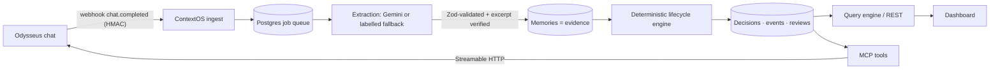

# ContextOS: 5-minute demo script

**Before going on stage:**
- Start the database, then both servers (see README).
- Run `npm run demo:seed`.
- Open `http://localhost:3000` and select **StudyMate (demo data)**.
- Keep a terminal ready for the MCP probe.

All StudyMate conversations are synthetic and labelled **Demo data** throughout the UI.

---

## Minute 1: The problem

> "AI assistants remember what you *said*. They don't know what you *decided*, what you actually *shipped*, or whether anyone *checked*. Six months into a project, 'we're considering Postgres', 'we decided Postgres', 'Postgres is migrated' and 'we still use Mongo' all look alike to a memory search. Odysseus's own memory dedup even drops 'StudyMate uses PostgreSQL' as a duplicate of 'StudyMate uses MongoDB'. We reproduced that against its source code."

## Minute 2: The solution

> "ContextOS is a decision-aware memory layer. The AI only **extracts** what each conversation says. A **deterministic lifecycle engine** decides what's true. It tracks two independent axes:
> - commitment: proposed → decided → rejected / cancelled / superseded
> - implementation: claimed → **verified**
>
> Every state change points to a verbatim excerpt from a stored conversation."

Show the **Overview** page:
- verified vs unverified counts
- the lifecycle charts
- recent activity, where every row quotes its evidence

## Minute 3: Live demonstration

1. Go to **Ingest conversations** and point at the 7 source conversations from January to June. Note the "Fallback extractor" or "Gemini" label on each.
2. Go to **Decision intelligence**:
   - PostgreSQL is **Decided · Verified**.
   - MongoDB is **Superseded by PostgreSQL**.
   - Redis is **Rejected**, with its reason.
   - Stripe is **Claimed · unverified**.
3. Click **PostgreSQL**:
   - Both axes are shown as steppers.
   - The lifecycle goes Proposed (Feb) → Decided (Mar) → Implementation claimed (Apr) → Verified (May), and each step quotes its source.

## Minute 4: Intelligence

1. Go to **Ask ContextOS** → *"What database does StudyMate currently use and why?"* The answer shows:
   - PostgreSQL, VERIFIED on 20 May, with clickable E1
   - the stated reason, "relational data requirements", with E2
   - MongoDB as historical (superseded)
   - a red notice: *"StudyMate still stores user data in MongoDB"* is **held for review and does not change the current state**. An unverified claim never overrides verified evidence.
2. Click **E2** to open the original conversation, with the cited message highlighted.
3. Open **Timeline**, filtered to *Conflicts & held*, then **Memory graph**: project → areas → options → lifecycle events → source conversations. Click a node.
4. Go to **Review queue**:
   - The conflict has *Confirm & apply* and *Dismiss* buttons. Dismiss it, and the database area returns to VERIFIED.
   - The unverified Stripe claim is listed beside it.
5. **Real MCP call** (terminal):
   ```powershell
   Get-Content integration-tests\odysseus\mcp_probe.py | docker exec -i -w /app odysseus-odysseus-1 python -
   ```
   This is Odysseus's own MCP client, running inside the Odysseus container. It discovers the 8 ContextOS tools and calls `get_current_state`, which returns the same PostgreSQL / VERIFIED packet.

## Minute 5: Architecture and impact



Key points:
- **Capture:** Odysseus webhooks (verified with Odysseus's real delivery code) plus manual ingestion.
- **Understand:** Gemini structured output, validated by Zod. Excerpts must appear verbatim in the source, or the transition is held.
- **Decide:** pure, tested state machine. Proposal ≠ decision ≠ implementation ≠ verification.
- **Answer:** current state comes from the projection, not from vector similarity. pgvector and full-text search only surface related memories.
- **Integrate:** 8 read-only MCP tools that return evidence-backed context packets for the Odysseus agent.

**Be accurate about integration:**
- MCP works through Odysseus's client code.
- Webhook delivery works through Odysseus's delivery code.
- A live chat-triggered webhook needs a public URL, because Odysseus blocks private addresses by design.
- The agent picking the tool on its own was not tested here (it needs a configured model).

## Backup questions

- *Which implementation claims are unverified?* → Stripe
- *What decisions were rejected?* → Redis, because of low traffic
- *Which commitments are overdue or unresolved?* → "Add payment failure alerts", due 15 Jun
- *What changed between January and May?*
- *What was the original database decision?* → MongoDB proposed, 12 Jan
